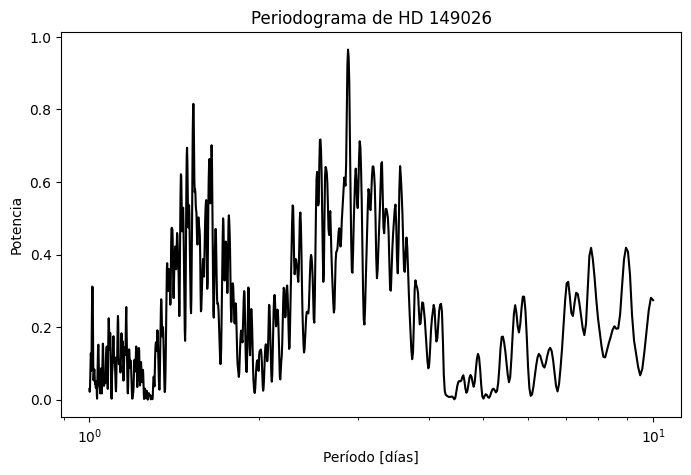
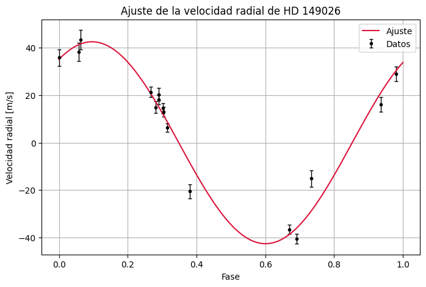
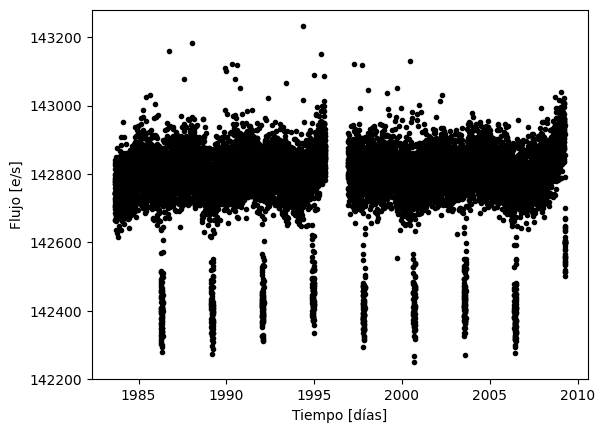
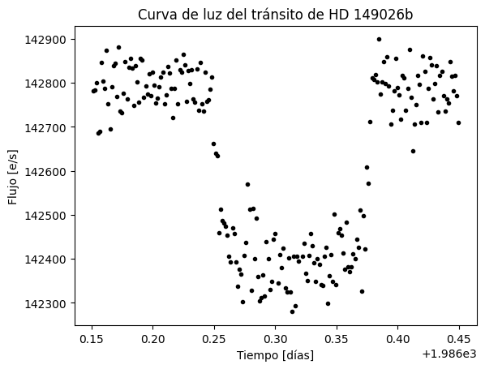
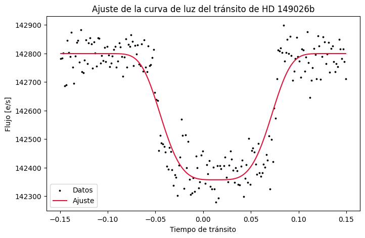
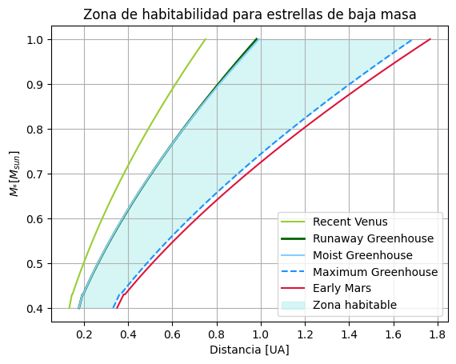

# HD 149026b: Radial-Velocity and Transit Analysis

**Undergraduate Astronomy Project · Universidad de Antioquia**  
**Author:** Manuela Marín Gómez  
**Focus:** Radial velocities · Transit photometry · Exoplanet characterization · Habitable-zone models

> **Portfolio archive of an undergraduate course project.** This repository includes the original eight-page report and figures extracted from it. The original Python notebook(s), input datasets, and data-reduction scripts have not yet been added. Reported numerical results have **not been independently revalidated** for this GitHub edition.

## Overview

This study investigates the exoplanet **HD 149026b** using radial-velocity measurements and transit photometry described in the accompanying report. The workflow combines **Lomb–Scargle period analysis**, a **sinusoidal fit to phase-folded radial velocities**, a descriptive **transit light-curve fit**, and a separate calculation of habitable-zone boundaries for stars of different masses.

The focus is the physics and methodology of characterizing a known transiting exoplanet, **not** claiming a new planetary discovery or that the planet itself lies in a habitable zone.

## Methods in the report

1. **Radial velocities:** use the Lomb–Scargle periodogram to identify a periodic signal and fit phase-folded velocity measurements using SciPy.
2. **Planetary mass:** infer the radial-velocity semi-amplitude and estimate the minimum planetary mass, \(M_p\sin i\).
3. **Transit photometry:** inspect transit light curves, fit the reported profile and estimate the planetary radius from the transit depth.
4. **Habitable zones:** calculate inner and outer boundaries under several climate criteria using stellar luminosity, effective temperature, and mass–luminosity relationships. This component compares stellar models rather than evaluating habitability of HD 149026b itself.

## Main results reported in the original document

| Quantity | Value reported |
| --- | ---: |
| Orbital period | 2.8756476 days |
| Radial-velocity semi-amplitude | 42.6 m/s |
| Minimum planetary mass \(M_p \sin i\) | 0.3515 Jupiter masses |
| Transit depth | 0.00309 |
| Planetary radius | 0.72 Jupiter radii |
| Orbital distance (reported in abstract) | 0.04364 ± 0.00022 AU |

These are **results quoted from the course report**, not newly computed estimates or independent confirmations.

## Selected figures

The images below were extracted from the original PDF without generating new fits or modifying the plots.

### Radial-velocity periodogram


### Phase-folded radial-velocity fit


### Light curve and transit fitting




### Habitable-zone boundaries


## Brief theoretical background

### Radial-velocity variation

For a nearly circular orbit, a simple approximation used for fitting periodic RV signals is

$$
v_r(t) \approx K\sin\left(\frac{2\pi t}{P}+\phi\right)+v_0,
$$

where \(K\) is the semi-amplitude, \(P\) the orbital period, \(\phi\) a phase, and \(v_0\) the systemic velocity offset. The report uses a sinusoidal fit; a complete eccentric-orbit analysis would require a Keplerian model.

The minimum planetary mass is constrained using the measured semi-amplitude together with the orbital period and host-star mass, under an assumed orbital eccentricity.

### Transit depth

In the small-planet, approximately uniform-stellar-disk limit,

$$
\delta\simeq\left(\frac{R_p}{R_\star}\right)^2,
$$

which connects the transit depth \(\delta\) to the ratio of planetary and stellar radii. Real transit models must account for limb darkening and orbital geometry; the report uses a descriptive fitting function.

### Habitable-zone distances

For stellar luminosity \(L\) and effective incident flux \(S_{\mathrm{eff}}\),

$$
d_{\mathrm{HZ}}=\sqrt{\frac{L/L_\odot}{S_{\mathrm{eff}}}}\,\mathrm{AU},
$$

where \(S_{\mathrm{eff}}\) is calculated from a temperature-dependent climate criterion. This defines a *model-dependent* range for potential surface liquid water on suitable rocky planets, not a direct assessment of a particular planet.

For equations, caveats, and explanations in Spanish, see [`docs/theory_es.md`](docs/theory_es.md).

## Repository contents

```text
hd149026b-rv-transit-analysis/
├── README.md
├── report/
│   └── HD149026b_Final_Report.pdf
├── figures/
│   ├── 01_radial_velocity_periodogram.png
│   ├── 02_radial_velocity_fit.png
│   ├── 03_transit_light_curve.png
│   ├── 04_transit_zoom.png
│   ├── 05_transit_fit.png
│   └── 06_habitable_zone.png
└── docs/
    ├── theory_es.md
    └── reproducibility_notes.md
```

## Original report and references

📄 **[Read the complete course report (PDF)](report/HD149026b_Final_Report.pdf)**, *Análisis de los datos de Velocidad Radial y Tránsito de HD 149026b y regiones de habitabilidad*, Manuela Marín Gómez, Universidad de Antioquia.

The report cites the NASA Exoplanet Archive, Sato et al. (2005), Bonomo et al. (2017), Kopparapu et al. (2013), and other literature. Please consult the PDF's reference list for the specific sources and context.

## Scope and next steps

- Add the original analysis notebooks / Python scripts and explain how to obtain the observational data.
- Verify the observational provenance, fitting assumptions, bibliography, and uncertainties against source datasets and papers.
- Re-run the workflow before making reproducibility claims.

This repository is a **documented course project**, not a peer-reviewed publication.
